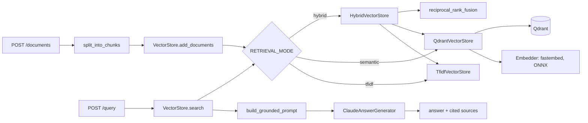

# Architecture

## Why generation is separate from retrieval

`rag/vector_store.py` and `rag/generation.py` know nothing about each other beyond the `SearchResult` they exchange. `RagPipeline` is the only piece that wires them together, which is what makes each one testable on its own: the stores are tested without a model or a network, and the generator is tested with a mocked HTTP client and no real store.

## One retrieval contract, three modes

Every store implements the same two methods, `add_documents(chunks)` and `search(query, top_k)`, declared as the `VectorStore` protocol in `rag/vector_store.py`. `RagPipeline` depends on that protocol and nothing else, and `rag/store_factory.py` is the only place that knows which concrete class serves which mode:

- **`tfidf`** is `TfidfVectorStore`: cosine similarity over TF-IDF vectors. It is the lexical baseline, runs entirely in process and needs no model download.
- **`semantic`** is `QdrantVectorStore`: chunks are embedded and indexed in Qdrant, and a query is embedded the same way and matched by cosine similarity. The embedding model sits behind the `Embedder` protocol in `rag/embeddings.py`, so the store never depends on a specific model; the real implementation uses fastembed, which runs ONNX models and keeps PyTorch out of the install. The Qdrant client is injected: in memory for tests and quick starts, a server through `QDRANT_URL` for real runs.
- **`hybrid`** is `HybridVectorStore`: it asks the lexical and the semantic store for their own rankings and merges them with Reciprocal Rank Fusion.

The mode comes from `RETRIEVAL_MODE` (default `hybrid`). The score on each returned source is mode specific: a TF-IDF cosine, an embedding cosine, or a fused rank score. Scores are only comparable within one response.

## Why Reciprocal Rank Fusion

TF-IDF cosine and embedding cosine live on different scales, so adding or averaging them needs a normalization step that quietly depends on the data. Reciprocal Rank Fusion sidesteps this: a chunk's fused score is the sum of `1 / (60 + rank)` over the rankings it appears in, so only the order matters. A chunk both stores agree on beats a chunk only one of them likes, and a store that finds nothing (TF-IDF on a pure paraphrase, for example) simply contributes nothing. The constant 60 is the value commonly used for RRF and has not been tuned on this project's data. Each store contributes its top 20 candidates, so a chunk ranked fifth by both can outrank one ranked first by only one.

## Why initialization is lazy

Building the semantic store downloads the embedding model on first use and connects to Qdrant, neither of which belongs in an import. `app.main` therefore builds the default pipeline in the application's startup hook, and `create_app(pipeline=...)` accepts a ready-made pipeline, which is how the tests run without any model. Importing `app.main` stays fast and offline.

## Why every answer carries its sources

A RAG answer that cannot be traced back to what it was grounded in is not meaningfully different from an ungrounded one. `build_grounded_prompt` numbers each retrieved chunk and instructs the model to cite those numbers, and the API response returns the chunks themselves alongside the answer, so a caller can verify a claim against the exact text it came from instead of trusting it blindly.

## Where this would need to change for production scale

The semantic half already runs on a vector database; the lexical half and the surrounding bookkeeping do not.

- `TfidfVectorStore` refits its vectorizer over every chunk on each ingest call and keeps everything in memory, which is fine for a small demo and wrong for a large, frequently updated corpus. Qdrant can hold sparse vectors next to dense ones and fuse them on the server, which would retire the in-process lexical index.
- `QdrantVectorStore` recreates its collection when the app starts, so the lexical and semantic indexes always describe the same chunks. That treats Qdrant as an index rebuilt from the sample corpus, not as the system of record. A production version would keep chunks in a durable store and re-index from it, which also covers re-embedding the corpus when the model changes.
- Embedding runs inside the request that ingests a document and inside the query path. At scale, ingestion belongs in a background worker with batched embedding calls.
- Semantic and hybrid retrieval always return the closest chunks, even for a question the corpus cannot answer; there is no similarity threshold, because a sensible one depends on the model and the corpus. The grounded prompt is what tells the model to say when the sources do not contain the answer.
- The evaluation set is 40 questions over 18 short notes. It is enough to compare the modes here and to catch a regression, not to predict quality on a real corpus.
